  

# 🔍 Awesome Search, Retrieval & Vector Indexing ⚡

  
  
  
  
  
  

---

## 🌟 Top Search & Retrieval Vector Indexing Ecosystem 🚀

**Curated Directory of Cloud SaaS Platforms & High-Performance Open-Source GitHub Projects**  
*Focused on Vector Databases, Approximate Nearest Neighbor (ANN) Indexing, Hybrid Lexical/Semantic BM25 Search Engines, Columnar Lance Pipelines, and RAG Infrastructure.*  

**Last updated: November 2026**

This repository tracks the modern **Search & Retrieval Vector Indexing** landscape powering GenAI, Retrieval-Augmented Generation (RAG), AI agent memory, and multimodal neural search. Whether you are indexing billions of high-dimensional dense embeddings with HNSW / IVF / DiskANN, building hybrid sparse-dense lexical retrieval pipelines with BM25 + SPLADE, or embedding zero-copy vector engines directly onto local edge devices, this guide aggregates production-proven hosted SaaS solutions and open-source engines.

---

## 📑 Table of Contents

- [📊 Sector Overview & Market Dynamics](#-sector-overview--market-dynamics)
- [☁️ SaaS/Hosted Search & Vector Platforms](#️-saashosted-search--vector-platforms)
- [💻 Open-Source GitHub Projects](#-open-source-github-projects)
- [📈 Star History](#-star-history)
- [🤝 How to Contribute](#-how-to-contribute)
- [💖 Support](#-support)
- [⚠️ Disclaimer](#️-disclaimer)

---

## 📊 Sector Overview & Market Dynamics

The global vector database, neural retrieval, and AI search market is valued at approximately **$1.8B – $2.6B** in 2025–2026 and is projected to expand past **$8B – $9.5B by 2030–2032** at a robust Compound Annual Growth Rate (CAGR) of **18% – 27%**, catalyzed by enterprise RAG architectures, generative AI agents, and multimodal embedding indexing.

The sector exhibits **moderate-to-high fragmentation** characterized by two converging forces rather than a pure winner-take-all outcome: specialized pure-play vector databases (such as *Pinecone, Qdrant, Milvus/Zilliz, and Weaviate*) and serverless object-store native engines (*turbopuffer*) compete intensely against established search and enterprise database titans (*Elasticsearch, OpenSearch, Algolia, and PostgreSQL with pgvector*) that have rapidly integrated native dense/sparse ANN indexing and hybrid BM25 retrieval.

---

## ☁️ SaaS/Hosted Search & Vector Platforms

Below is a comparison of leading managed cloud search and vector database platforms, sorted in descending order by company scale (**Market Capitalization / Private Valuation / Estimated Annual Revenue**):

| Platform | Company Scale (Valuation / Revenue) | Starting Price (Paid Tier) | Free Tier / Trial Limits | Key Architecture & Features |
| :--- | :--- | :--- | :--- | :--- |
| **[Elastic Cloud](https://elastic.co)** | **~$8.5B – $9.5B Market Cap** *(ESTC; ~$1.74B ARR)* | **$95 – $99 / month** *(Standard hosted cluster baseline)* | **14-day free trial** *(1 hosted deployment up to 8 GB RAM across 2 AZs; no credit card required)* | Enterprise search suite offering BM25 lexical retrieval, dense HNSW vector search, ELSER learned sparse embeddings, and AI semantic reranking. |
| **[Algolia](https://algolia.com)** | **~$2.25B Valuation** *(~$100M+ ARR; Series D)* | **$0.50 / 1,000 search requests** + **$0.40 / 1,000 records** *(Grow pay-as-you-go base)* | **Free forever (Build plan)** *(10,000 search requests/month, up to 100,000 records, standard analytics)* | Instant search-as-a-service and NeuralSearch engine combining typo-tolerant lexical lookup with semantic vector discovery. |
| **[Pinecone](https://pinecone.io)** | **~$750M Valuation** *(~$26M+ ARR; Series B)* | **$20 / month** *(Builder fixed tier or $0.000045/GB-hr serverless)* | **Free forever (Starter plan)** *(2 GB storage, 1M read units/mo, 2M write units/mo, up to 5 serverless indexes, AWS us-east-1)* | AI-native serverless vector database engineered for ultra-low latency similarity search, metadata filtering, and high-throughput RAG workloads. |
| **[turbopuffer](https://turbopuffer.com)** | **~$75M – $100M ARR** *(Backed by Thrive Capital & Lachy Groom)* | **$16 / month minimum spend floor** *(Launch tier; usage metered for storage, reads, and writes)* | **No free tier** *(Promotional signup credits upon launch; $16/mo minimum consumption applies)* | Serverless vector and full-text search engine built directly on top of object storage (S3/GCS) with dynamic multi-tenant caching for high-scale RAG. |
| **[Zilliz Cloud](https://zilliz.com)** | **~$200M – $400M Valuation** *(~$25M – $40M ARR; $113M raised)* | **$65 / month** *(Serverless CU consumption or dedicated cluster tiers)* | **Free forever (Serverless plan)** *(5 GB storage, 2.5 million vCUs/month, up to 5 collections, Slack community support)* | Fully managed cloud service built on Milvus offering auto-scaling vector indexing, tiered memory/disk storage, and GPU-accelerated ANN compute. |
| **[Weaviate Cloud](https://weaviate.io)** | **~$200M Valuation** *(~$15M – $21M ARR; Series B)* | **$45 / month minimum floor** *(Flex Pay-as-you-go serverless tier)* | **Free forever (Free Sandbox)** *(1 cluster, 100,000 objects, 1 GB RAM / 10 GB disk, 1 collection, 2K embedding requests/day)* | Managed AI-native vector database combining hybrid keyword/vector search, modular vectorizers, and granular multi-tenant isolation. |
| **[Qdrant Cloud](https://qdrant.io)** | **~$150M – $250M Valuation** *(~$10M – $14M ARR; $88M raised)* | **~$25 – $40 / month** *(Standard cluster minimum based on provisioned RAM/vCPU)* | **Free forever (Free tier)** *(1 node, 0.5 vCPU, 1 GB RAM, 4 GB disk, ~1M 768-dim vectors; suspends after 7 days inactivity)* | Managed cloud vector search engine written in Rust featuring advanced payload filtering, scalar/binary quantization, and hybrid sparse-dense support. |
| **[Meilisearch Cloud](https://meilisearch.com)** | **~$60M – $100M Valuation** *(~$3.6M ARR; $22M raised)* | **$14.88 / month** *(XS instance: 0.5 vCPU, 1 GB RAM, regional bandwidth)* | **14-day free trial** *(Full platform features, 20 MB API upload limit, no credit card required)* | Fast, developer-friendly cloud search service powered by Rust with out-of-the-box typo tolerance, faceted filtering, and semantic search. |
| **[Typesense Cloud](https://typesense.org)** | **Bootstrapped / Profitable** *(~$1.4M ARR; Self-funded)* | **$21.60 / month** *(0.5 GB RAM, 2 burst vCPUs node tier)* | **720 hours (~30 days) free trial** *(1 cluster, 10 GB bandwidth, full features, no credit card required)* | Managed in-memory search engine providing sub-50ms typo-tolerant full-text search, semantic vector retrieval, and conversational AI RAG endpoints. |

---

## 💻 Open-Source GitHub Projects

Below are the most prominent open-source vector databases, similarity search engines, Postgres vector extensions, and embedding pipelines, **sorted in descending order by GitHub_Stars** (with real-time social badges linking directly to each repository's stargazers):

| Open-Source Project | GitHub_Stars | Core Language / Stack | Primary Focus & Capabilities |
| :--- | :--- | :--- | :--- |
| **[Meilisearch](https://github.com/meilisearch/meilisearch)** |  | `Rust` | Ultra-fast, typo-tolerant search engine with hybrid search, vector embeddings, and instant relevance scoring. |
| **[Milvus](https://github.com/milvus-io/milvus)** |  | `Go` / `C++` | Cloud-native distributed vector database built for billion-scale similarity search with GPU and DiskANN acceleration. |
| **[FAISS](https://github.com/facebookresearch/faiss)** |  | `C++` / `CUDA` / `Python` | Meta's foundational library for dense vector clustering, inverted multi-indexes, and hardware-accelerated ANN similarity search. |
| **[Qdrant](https://github.com/qdrant/qdrant)** |  | `Rust` | High-performance vector database with rich JSON payload filtering, scalar/binary quantization, and sparse vector retrieval. |
| **[Chroma](https://github.com/chroma-core/chroma)** |  | `Python` / `Rust` | AI-native open-source embedding database designed for developer productivity, RAG tooling, and local-to-cloud workflows. |
| **[Typesense](https://github.com/typesense/typesense)** |  | `C++` | Fast, in-memory typo-tolerant search engine with built-in vector search, conversational RAG, and geo-spatial querying. |
| **[pgvector](https://github.com/pgvector/pgvector)** |  | `C` | Native vector similarity search extension for PostgreSQL supporting HNSW and IVFFlat indexes alongside relational joins. |
| **[Weaviate](https://github.com/weaviate/weaviate)** |  | `Go` | Open-source vector database featuring hybrid BM25F + vector retrieval, multi-tenant isolation, and modular ML plugins. |
| **[Tantivy](https://github.com/quickwit-oss/tantivy)** |  | `Rust` | Full-text search engine library in Rust inspired by Apache Lucene, delivering blazing-fast lexical indexing and BM25 ranking. |
| **[Annoy](https://github.com/spotify/annoy)** |  | `C++` / `Python` | Spotify's classic C++/Python library for Approximate Nearest Neighbors with memory-mapped disk indexing. |
| **[OpenSearch](https://github.com/opensearch-project/OpenSearch)** |  | `Java` | Distributed open-source search and analytics suite offering k-NN vector indexing, neural sparse retrieval, and hybrid search. |
| **[txtai](https://github.com/neuml/txtai)** |  | `Python` | All-in-one embeddings database for semantic search, LLM orchestration, knowledge graphs, and RAG pipelines. |
| **[LanceDB](https://github.com/lancedb/lancedb)** |  | `Rust` / `Python` | Serverless open-source vector database built on the columnar Lance format for zero-copy multimodal disk-based ANN search. |
| **[CocoIndex](https://github.com/cocoindex-io/cocoindex)** |  | `Rust` / `Python` | High-speed data transformation and continuous incremental indexing framework for vector, graph, and keyword stores. |
| **[Quickwit](https://github.com/quickwit-oss/quickwit)** |  | `Rust` | Cloud-native search engine designed to execute sub-second full-text and log search directly on top of cloud object storage. |
| **[sqlite-vec](https://github.com/asg017/sqlite-vec)** |  | `C` | Zero-dependency, pure-C vector search extension for SQLite running in browsers (WASM), mobile apps, and edge devices. |
| **[Vespa](https://github.com/vespa-engine/vespa)** |  | `C++` / `Java` | Production-grade search and serving engine combining vector similarity, lexical BM25, tensor evaluation, and online ranking. |
| **[pgai](https://github.com/timescale/pgai)** |  | `Python` / `PL/pgSQL` | Timescale's PostgreSQL extension suite for automating vector embedding creation, semantic search, and RAG workflows in SQL. |
| **[hnswlib](https://github.com/nmslib/hnswlib)** |  | `C++` | Fast, header-only C++ library implementing Hierarchical Navigable Small World graphs for low-overhead approximate nearest neighbor lookup. |
| **[Marqo](https://github.com/marqo-ai/marqo)** |  | `Python` / `Go` | End-to-end multimodal tensor search engine integrating document chunking, embedding generation, and vector indexing. |
| **[Infinity](https://github.com/infiniflow/infinity)** |  | `C++` | AI-native database delivering ultra-fast dense vector search, sparse vector matching, full-text search, and tensor reranking. |
| **[USearch](https://github.com/unum-cloud/usearch)** |  | `C++` / `C` | Compact, hardware-accelerated vector search engine implementing HNSW with scalar and binary quantization across 10+ languages. |
| **[pgvecto.rs](https://github.com/tensorchord/pgvecto.rs)** |  | `Rust` | Scalable vector database plugin for PostgreSQL written in Rust supporting HNSW, VFlat, and IVF indexes. |
| **[Vald](https://github.com/vdaas/vald)** |  | `Go` | Highly scalable, cloud-native distributed vector search engine built on Kubernetes and the NGT similarity graph algorithm. |
| **[rerankers](https://github.com/AnswerDotAI/rerankers)** |  | `Python` | Unified interface for neural reranking engines (Cross-Encoders, FlashRank, ColBERT, Cohere) to enhance top-k retrieval accuracy. |
| **[FlashRank](https://github.com/PrithivirajDamodaran/FlashRank)** |  | `Python` | Ultra-lightweight, ultra-fast neural reranking library based on ONNX runtime with zero PyTorch / TensorFlow dependency. |

---

## 📈 Star History

---

## 🤝 How to Contribute

We welcome community contributions! To add a new vector engine, search framework, or indexing tool:

1. 🍴 **Fork the repository** on GitHub.
2. 🌿 **Create a new branch** (`git checkout -b add-retrieval-tool`).
3. 📝 **Add your entry** under the appropriate table or section (ensure descriptions are concise and factual).
4. 📬 **Submit a Pull Request** with a brief summary of why the tool is beneficial to the retrieval community.

For curated awesome lists and inspirations, check out [Awesome-Awesome-Awesome](https://github.com/ishandutta2007/Awesome-Awesome-Awesome).

---

## 💖 Support

If you find this directory valuable for your AI architecture or search infrastructure:
- ⭐ **Star this repository** to help other engineers discover it.
- 🍴 **Fork and share** with your data science, ML, and platform teams.
- ☕ **Sponsor the maintainer** or buy a coffee via the [GitHub Sponsor Dashboard](https://github.com/sponsors/ishandutta2007).

---

## ⚠️ Disclaimer

- This is an independent, community-maintained ecosystem directory and does not constitute an endorsement.
- High-dimensional vector indexes (HNSW, IVF, flat) consume significant RAM and disk IOPS; evaluate quantization (`SQ8`, `BQ`) or columnar disk-backed formats (`LanceDB`, `DiskANN`) for massive embedding datasets.
- Self-hosted database nodes should never be exposed to public networks without TLS encryption, authentication keys, and VPC firewall isolation.

---

  <b>Built with ❤️ for AI Engineers, Search Architects, Data Platform Builders, and Open-Source Enthusiasts.</b> 
  <i>Accelerating high-scale similarity search, RAG accuracy, and semantic retrieval everywhere.</i>

